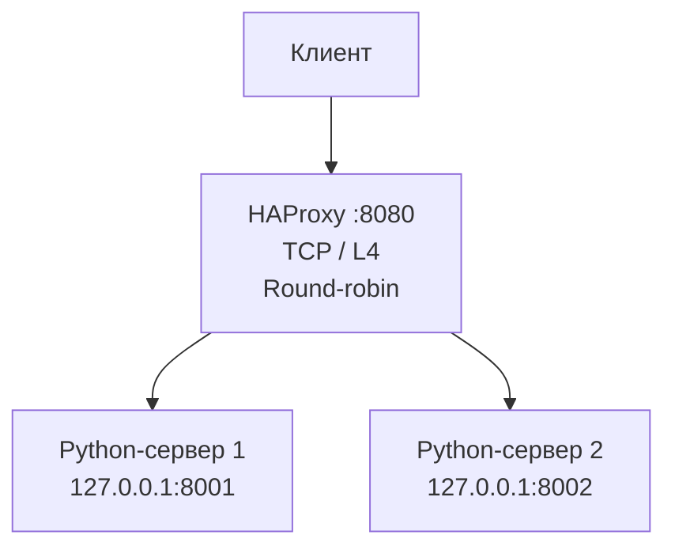
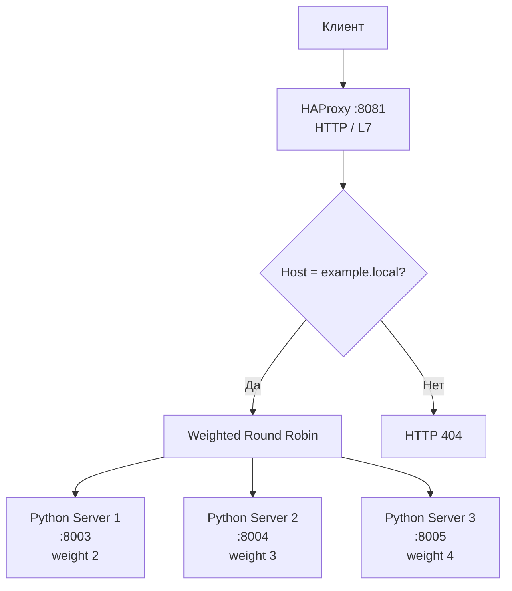

Задание 1. Round-robin на 4-м уровне
Цель
Запустить два простых Python HTTP-сервера на разных портах и настроить
HAProxy так, чтобы он распределял TCP-соединения между ними по алгоритму
Round-robin.
Схема работы

HAProxy работает в режиме tcp: он распределяет TCP-соединения, не
анализируя HTTP-заголовки и содержимое запросов.
1. Подготовка двух Python-серверов
Создадим отдельные каталоги с разными главными страницами. Это позволит
определить, какой сервер ответил на запрос.
mkdir -p ~/haproxy-lab/server1 ~/haproxy-lab/server2

echo '<h1>Ответ от Python Server 1 (port 8001)</h1>' > ~/haproxy-lab/server1/index.html
echo '<h1>Ответ от Python Server 2 (port 8002)</h1>' > ~/haproxy-lab/server2/index.html
Запустим серверы на портах 8001 и 8002:
nohup python3 -m http.server 8001 \
  --bind 127.0.0.1 \
  --directory ~/haproxy-lab/server1 \
  > ~/haproxy-lab/server1.log 2>&1 &

nohup python3 -m http.server 8002 \
  --bind 127.0.0.1 \
  --directory ~/haproxy-lab/server2 \
  > ~/haproxy-lab/server2.log 2>&1 &
Проверим, что оба сервера отвечают напрямую:
curl http://127.0.0.1:8001/
curl http://127.0.0.1:8002/
В ответах должны быть разные названия серверов.
2. Конфигурация HAProxy для L4
Фрагмент /etc/haproxy/haproxy.cfg:
global
    log /dev/log local0
    log /dev/log local1 notice
    daemon

defaults
    log global
    timeout connect 5s
    timeout client  30s
    timeout server  30s

frontend tcp_frontend
    bind *:8080
    mode tcp
    default_backend python_tcp_servers

backend python_tcp_servers
    mode tcp
    balance roundrobin
    server python1 127.0.0.1:8001 check
    server python2 127.0.0.1:8002 check
Пояснение:
- bind *:8080 --- HAProxy принимает подключения на порту 8080.
- mode tcp --- балансировка выполняется на транспортном уровне L4.
- balance roundrobin --- запросы/соединения распределяются по
  очереди.
- check --- HAProxy проверяет доступность серверов.
3. Проверка Round-robin
После сохранения конфигурации проверим её синтаксис и перезапустим
HAProxy:
sudo haproxy -c -f /etc/haproxy/haproxy.cfg
sudo systemctl restart haproxy
sudo systemctl status haproxy
Выполним несколько отдельных запросов через HAProxy:
for i in $(seq 1 6); do
    echo "Запрос $i:"
    curl -s http://127.0.0.1:8080/
    echo
done
Ожидается, что ответы будут чередоваться между Python Server 1 и Python
Server 2. Фактический порядок следует подтвердить выводом команды в
своей среде.
Задание 2. Weighted Round Robin на 7-м уровне
Цель
Запустить три Python-сервера и настроить HAProxy в режиме HTTP (L7).
Балансировка должна выполняться только для запросов, адресованных домену
example.local.

Веса серверов:

  Сервер              Порт   Вес
  Python Server 1     8003     2
Python Server 2     8004     3
Python Server 3     8005     4
Схема работы

1. Подготовка трёх Python-серверов
Создадим каталоги и разные главные страницы:
mkdir -p ~/haproxy-lab/server3 ~/haproxy-lab/server4 ~/haproxy-lab/server5

echo '<h1>Python Server 1 - weight 2</h1>' > ~/haproxy-lab/server3/index.html
echo '<h1>Python Server 2 - weight 3</h1>' > ~/haproxy-lab/server4/index.html
echo '<h1>Python Server 3 - weight 4</h1>' > ~/haproxy-lab/server5/index.html
Запустим серверы:
nohup python3 -m http.server 8003 \
  --bind 127.0.0.1 \
  --directory ~/haproxy-lab/server3 \
  > ~/haproxy-lab/server3.log 2>&1 &

nohup python3 -m http.server 8004 \
  --bind 127.0.0.1 \
  --directory ~/haproxy-lab/server4 \
  > ~/haproxy-lab/server4.log 2>&1 &

nohup python3 -m http.server 8005 \
  --bind 127.0.0.1 \
  --directory ~/haproxy-lab/server5 \
  > ~/haproxy-lab/server5.log 2>&1 &
2. Конфигурация HAProxy для L7
Для второго задания добавим HTTP frontend и backend. HAProxy проверяет
заголовок Host. Если домен не равен example.local, возвращается HTTP
404 и запрос не передаётся серверам балансировки.

Фрагмент /etc/haproxy/haproxy.cfg:
frontend http_frontend
    bind *:8081
    mode http

    acl host_example hdr(host) -m reg -i ^example\.local(:[0-9]+)?$
    http-request deny deny_status 404 unless host_example

    default_backend weighted_python_servers

backend weighted_python_servers
    mode http
    balance roundrobin
    server python1 127.0.0.1:8003 weight 2 check
    server python2 127.0.0.1:8004 weight 3 check
    server python3 127.0.0.1:8005 weight 4 check
Пояснение:
- mode http --- HAProxy анализирует HTTP-запросы и заголовки.
- acl host_example ... --- проверяет доменное имя в заголовке
  Host.
- http-request deny ... unless host_example --- отклоняет запросы с
  другим доменом.
- balance roundrobin --- включает взвешенное распределение по
  очереди.
- weight 2, weight 3, weight 4 --- задают относительную долю
  запросов для серверов.
При исправной работе всех трёх серверов соотношение распределения должно
стремиться к 2 : 3 : 4.
Если оба задания выполняются на одной машине, блоки frontend и
backend из заданий 1 и 2 можно разместить в одном файле
haproxy.cfg. Порты прослушивания должны оставаться разными: 8080 и
8081.

3. Проверка домена
Для локальной проверки можно обращаться к HAProxy по адресу 127.0.0.1,
явно задавая заголовок Host:
curl -i -H "Host: example.local" http://127.0.0.1:8081/
Ожидается ответ одного из трёх Python-серверов.

Проверим запрос без нужного домена:
curl -i http://127.0.0.1:8081/
Ожидается ответ HTTP 404. Это подтверждает, что запрос без
Host: example.local не направляется в балансируемую группу.

Также можно проверить с другим доменом:
curl -i -H "Host: other.local" http://127.0.0.1:8081/
Ожидается HTTP 404.
4. Проверка весов 2 : 3 : 4
Отправим серию запросов с правильным заголовком Host:
for i in $(seq 1 18); do
    echo "Запрос $i:"
    curl -s -H "Host: example.local" http://127.0.0.1:8081/
    echo
done
В серии запросов ответы должны распределяться между тремя серверами с
учётом заданных весов. Для оценки соотношения удобно выполнить несколько
циклов запросов и подсчитать количество ответов каждого сервера.
Проверка конфигурации HAProxy
После объединения конфигураций двух заданий проверьте файл:
sudo haproxy -c -f /etc/haproxy/haproxy.cfg
Если синтаксис корректен, HAProxy сообщит об успешной проверке
конфигурации. Затем примените настройки:
sudo systemctl restart haproxy
sudo systemctl status haproxy
Проверить открытые порты можно командой:
sudo ss -lntp | grep haproxy
Материалы и скриншоты для сдачи
После фактического выполнения добавьте в репозиторий каталог
screenshots и сохраните в нём собственные скриншоты.

Рекомендуемые имена файлов:
  Файл                                           Что должно быть видно
  screenshots/task1-python-servers.png         Запущены два Python-сервера

  screenshots/task1-round-robin.png            Ответы двух серверов при запросах
через HAProxy

  screenshots/task2-python-servers.png         Запущены три Python-сервера

  screenshots/task2-weighted-round-robin.png   Ответы трёх серверов при запросах с
Host: example.local

  screenshots/task2-domain-filter.png          Ответ 404 для запроса без нужного
домена
screenshots/haproxy-config.png               Конфигурация HAProxy с обоими
frontend/backend
Когда изображения будут добавлены в каталог screenshots, их можно
отобразить в README следующими ссылками:

Итоги
В работе рассматриваются два режима балансировки нагрузки с помощью
HAProxy:
1. L4 / TCP Round-robin: распределение TCP-соединений между двумя
   Python-серверами по очереди.
2. L7 / HTTP Weighted Round Robin: распределение HTTP-запросов
   между тремя серверами с весами 2, 3 и 4. Запросы допускаются к
   балансировке только при обращении к домену example.local.
Проверка считается завершённой после подтверждения чередования ответов
двух серверов в первом задании, распределения запросов с учётом весов во
втором задании и получения HTTP 404 для запросов с неподходящим доменом.